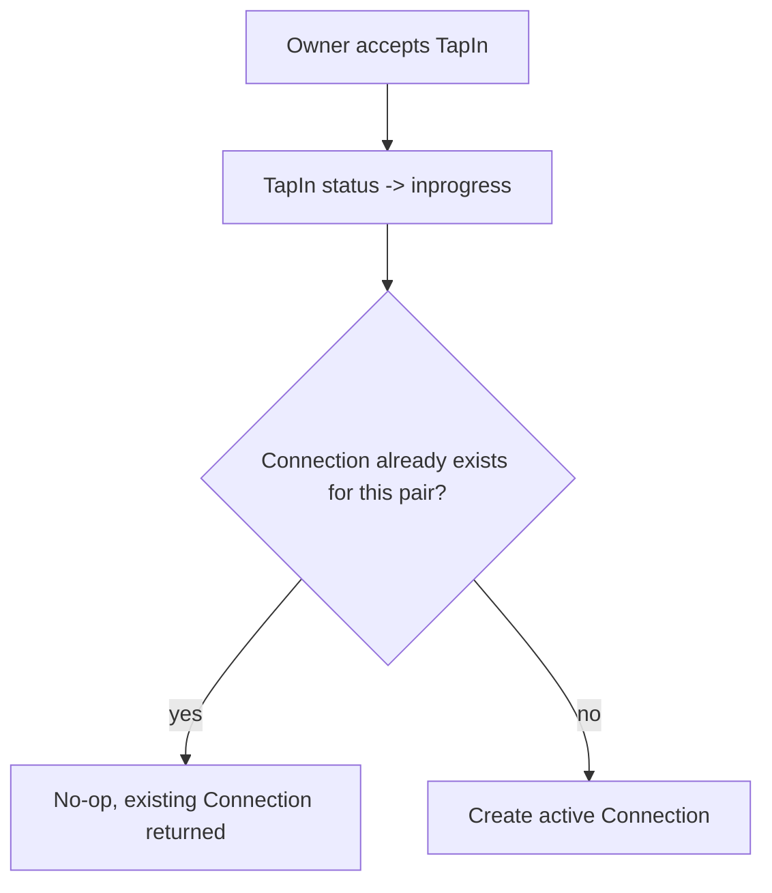
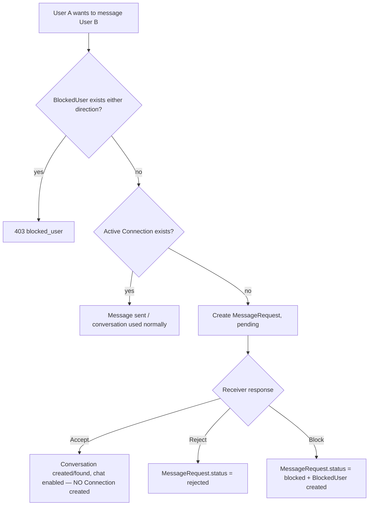
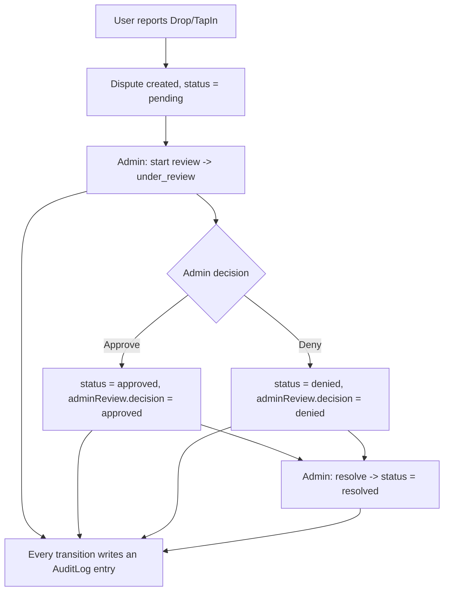

# Connections, Message Requests, Blocking & Disputes

This document covers the new social-graph and moderation features: **Connections**, **Message
Requests**, **User Blocking**, and **Disputes** (with admin review). All endpoints follow the
existing project conventions: `sendResponse` for JSON envelopes, `validateParams` for input
validation, `parsePaginationParams`/`generateMeta` for paged lists, and the legacy
`middlewares/authMiddleware` + `middlewares/roleMiddleware` for auth/role gating.

## 1. Data model

| Model | Purpose | Key fields |
|---|---|---|
| `Connection` (`backend/models/Connection.js`) | One document per user pair, tracking whether two users are connected | `user1`, `user2` (normalized, `user1 < user2`), `status` (`active`/`blocked`/`removed`), `source.tapInId` |
| `MessageRequest` (`backend/models/MessageRequest.js`) | A request to start chatting with a non-connected user | `sender`, `receiver`, `message`, `status` (`pending`/`accepted`/`rejected`/`blocked`) |
| `BlockedUser` (`backend/models/BlockedUser.js`) | User-level block | `blockedBy`, `blockedUser`, `reason` |
| `Dispute` (`backend/models/Dispute.js`) | A report against a `Drop` or `TapIn` | `reportedBy`, `reportedAgainst`, `drop`, `tapIn`, `reason`, `description`, `evidence`, `status`, `adminReview` |
| `AuditLog` (`backend/models/AuditLog.js`) | Immutable record of admin actions | `action`, `entity`, `entityId`, `performedBy`, `performedByName`, `oldValues`, `newValues` |

Duplicate protection is enforced with unique indexes (not just application checks), so concurrent
requests cannot create duplicate rows:

- `Connection`: unique `{ user1, user2 }`.
- `MessageRequest`: unique `{ sender, receiver }` **partial** on `status: "pending"` (history of
  past requests is preserved; only one open request at a time).
- `BlockedUser`: unique `{ blockedBy, blockedUser }`.

`ensureConnection()` (`backend/helperUtils/connectionUtil.js`) uses an atomic
`findOneAndUpdate(..., { upsert: true })` with `$setOnInsert`, so two simultaneous "first tap-in
between these two users" events can't race into two Connection documents — the loser of the race
simply reads back the winner's document.

## 2. Business flow

### 2.1 Connection creation (TapIn → Connection)

Implemented in `tapInService.acceptTapIn()` (`backend/roles/user/tapIns/tapInService.js`): once the
tap-in is marked `inprogress`, `ensureConnection(ownerId, applicantId, { tapInId })` is called. The
call is wrapped in `try/catch` and never throws back to the caller — a failure to create the
Connection (e.g. Mongo unavailable in an in-memory test run) never blocks the tap-in accept flow.

### 2.2 Messaging (block → connection → message request)

This is enforced in two places:

1. **`POST /api/v1/message-requests`** — the dedicated Message Request API (used when the client
   wants an explicit "request to connect" UX).
2. **`POST /api/v1/conversations/message`** (existing chat endpoint,
   `backend/commonModules/chatModule/controllers/messageController.js`) — when starting a **new**
   direct conversation (`conversationType: "direct"`, no `conversationId`), the controller now:
   - Rejects with `403 blocked_user` if either user has blocked the other (checked both for brand
     new conversations and for continuing an existing conversation).
   - If the pair has an active `Connection`, behaves exactly as before (finds/creates the
     conversation and sends the message).
   - If not connected, no conversation/message is created — instead a `MessageRequest` is created
     and `201 message_request_sent` is returned.

### 2.3 Disputes

`Dispute` creation validates that the reference is relevant to the two parties
(`backend/controllers/disputesController.js#validateDisputeTarget`):

- If `tapIn` is given: both `reportedBy` and `reportedAgainst` must be the tap-in's `ownerId`/
  `applicantId`, and (if also given) `drop` must match the tap-in's `dropId`.
- If only `drop` is given: `reportedAgainst` must be the drop's `ownerId`, and `reportedBy` cannot
  be the drop owner (can't report your own drop).
- At least one of `drop`/`tapIn` is required; self-reports (`reportedAgainst === reportedBy`) are
  rejected.

## 3. API reference

All endpoints require `Authorization: Bearer <token>` unless noted.

### Connections — `/api/v1/connections`

| Method | Path | Description |
|---|---|---|
| GET | `/` | List my connections. Query: `status` (`active` default, `blocked`, `removed`), `page`, `limit`. |
| GET | `/:userId` | Connection + block status between me and `:userId`. |
| DELETE | `/:userId` | Soft-remove (status → `removed`) my connection with `:userId`. |

### Message Requests — `/api/v1/message-requests`

| Method | Path | Description |
|---|---|---|
| POST | `/` | Create a request. Body: `receiverId`, `message` (optional, ≤500 chars). `403` if blocked, `409` if already connected or a pending request already exists. |
| GET | `/incoming` | Requests sent to me. Query: `status`, `page`, `limit`. |
| GET | `/outgoing` | Requests I sent. Query: `status`, `page`, `limit`. |
| POST | `/:id/accept` | Accept — creates/reuses a direct conversation (does **not** create a Connection) and posts the original message as the first chat message. |
| POST | `/:id/reject` | Reject. |
| POST | `/:id/block` | Reject + block the sender (creates a `BlockedUser` row). |

### Blocked Users — `/api/v1/blocked-users`

| Method | Path | Description |
|---|---|---|
| POST | `/` | Block a user. Body: `userId`, `reason` (optional). Sets any existing `Connection` to `blocked` and cancels the sender's pending message requests to me. `409` if already blocked. |
| GET | `/` | List users I've blocked. |
| DELETE | `/:userId` | Unblock. Restores the `Connection` to `active` if the other user hasn't also blocked me. |

### Disputes (user-facing) — `/api/v1/disputes`

| Method | Path | Description |
|---|---|---|
| POST | `/` | Create a dispute. Body: `reportedAgainst`, `reason`, `drop` and/or `tapIn`, `description` (optional), `evidence` (optional, array of URLs, ≤10). |
| GET | `/` | My disputes. Query: `role` (`reported` default, `against`, `all`), `status`, `page`, `limit`. |
| GET | `/:id` | Dispute detail (only visible to the two parties or an admin). |

### Disputes (admin) — `/api/v1/admin/disputes` — requires `userType: admin`

| Method | Path | Description |
|---|---|---|
| GET | `/` | List all disputes. Query: `status`, `page`, `limit`. |
| GET | `/:id` | Dispute detail, populated with reporter/reported/reviewer info. |
| POST | `/:id/review` | `pending` → `under_review`. Body: `note` (optional). |
| POST | `/:id/approve` | `pending`/`under_review` → `approved`. Body: `note` (optional). |
| POST | `/:id/deny` | `pending`/`under_review` → `denied`. Body: `note` (optional). |
| POST | `/:id/resolve` | `approved`/`denied` → `resolved`. |

Invalid transitions (e.g. approving an already-resolved dispute) return `409
dispute_invalid_status_transition`. Every transition writes an `AuditLog` row with the admin's id/
name, the action, and the before/after `status`+`adminReview`.

## 4. Tests

`tests/tradedrop/connectionsDisputes.mongo.test.js` (run via `npm run test:mongo`, requires
`MONGO_URI_TEST`) covers:

- Connection auto-creation on tap-in accept, and that a **second** tap-in between the same two
  users does not create a duplicate Connection.
- Blocking prevents new message requests from the blocked user.
- Message request lifecycle (create → duplicate rejected → accept enables chat → no Connection
  created; reject; block-via-request prevents further requests).
- Dispute creation validation (self-report rejected, non-participant rejected, valid case accepted).
- Admin dispute review flow (403 for non-admins, review → approve → resolve, invalid transition
  rejected, deny path) plus audit log verification.

Note: `.mocharc.json` now registers the project's `@alias` module paths
(`tests/helpers/registerAliases.js`) before any test file loads. This was required for the
pre-existing `*.mock.test.js`/`*.mongo.test.js` suites too — previously `npm test`/`npm run
test:mongo` failed immediately with `Cannot find module '@helperUtils/...'` because
`module-alias/register` was only ever called from `backend/server.js`, never from the test entry
point.
